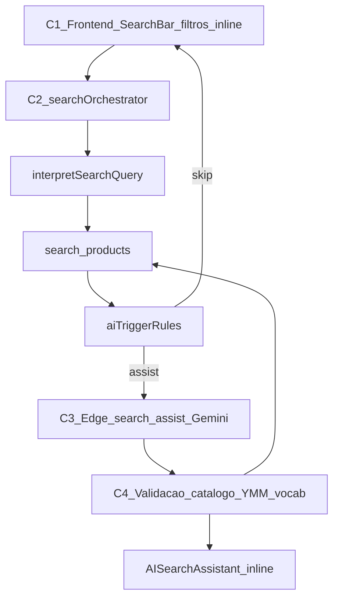

# HF AI Search — Plano completo (canônico)

**Status:** CANÔNICO  
**Data:** 2026-11-24  
**Projeto:** HF Comércio de Peças · Supabase `owllmfcpbodqmoerdfxx` · Front Hostinger  
**Regra:** nunca alterar pasta FAL (só referência de leitura)  
**Produto:** camada inteligente do **HF Search Engine** — não chatbot, não SoT, não substituto de `search_products`.

Doc curto 3.1: [HF_AI_SEARCH.md](./HF_AI_SEARCH.md)

---

## 0. Decisões fundamentais (congeladas)

| # | Decisão |
|---|--------|
| D1 | IA nos bastidores: interpreta / corrige / sugere; cliente encontra produto com menos esforço |
| D2 | Modelo **híbrido**: determinístico sempre primeiro; IA só por triggers configuráveis |
| D3 | Experiência **inline** (você quis dizer / sugestões / esclarecer) — aceitar ou rejeitar; sem auto-aplicar |
| D4 | Provedor default **Google Gemini** (secret Edge); interface `AIProvider` trocável (OpenAI/Claude futuros) |
| D5 | IA **não** consulta banco com SQL livre; backend valida; catálogo confirma via RPC |
| D6 | Filtros: **manual > texto explícito > sugestão IA > herdado** — IA não sobrescreve manual em silêncio |
| D7 | Sem `pgvector` / vetorial externo até Fase 3.4 (cadastro pequeno + refs zeradas) |
| D8 | Credenciais só Edge secrets; front no máximo `VITE_SEARCH_NL_LLM=0\|1` |
| D9 | Empty tipado distingue “reconheceu sem produtos” vs “não interpretou” |
| D10 | Selo de compatibilidade honesto (PVC); copy motivo/faltante; PDP com fit da URL |

### Cinco situações que a IA auxilia

1. Digitação incorreta do nome da peça  
2. Abreviações / nomes populares  
3. Descrição sem nome técnico  
4. Texto + filtros de veículo  
5. Busca convencional insatisfatória (zero/ambíguo)

---

## 1. Arquitetura em 4 camadas



| Camada | Responsabilidade | Artefatos HF |
|--------|------------------|--------------|
| C1 Frontend | SearchBar, filtros, empty tipado, selo, futuro assist inline | `CatalogPage`, `SearchBar`, `CompatibilityStateBadge`, `resolveSearchEmptyOutcome` |
| C2 Orquestrador | Coordena det → RPC → decide IA | `searchOrchestrator.ts`, `aiTriggerRules.ts` |
| C3 IA | Correção / intent / contexto via Gemini | Edge `search-assist`, `aiProvider.ts` |
| C4 Validação | Merge anti-alucinação + reconsulta RPC | catálogo `listVehicleCatalogEntries`, vocabulário PRODUCT_WORDS, merge (3.2+) |

---

## 2. Estado atual (o que já está pronto)

### 2.1 Search Engine Nível 2 (Etapa 2) — DONE

- `interpretSearchQuery` + `intentType` / `matchedEntities`
- `buildCatalogSearchParams` + regras A–F + `applyIntentToSearchParams`
- Soft empty fallback (versão → só `q`)
- RPC `search_products` (PVC inclui VV inactive de app)
- Branch/`dev` histórico de busca inteligente

### 2.2 Fase A (validação ID/compat/selo/empty) — DONE

- Smoke ID: CELTA, HB20X, unknown (`veiculozorro`)
- Empty tipado: `vehicle_recognized_no_products` · `not_interpreted` · etc.
- Selo: `compatCopy`, label **Compatível similar**, PDP com verdict da URL
- Prioridade empty: veículo reconhecido sem produtos > “qual peça?”

### 2.3 Gemini secret + link CLI — DONE

- Projeto linked: `owllmfcpbodqmoerdfxx`
- Secrets: `GEMINI_API_KEY`, `GEMINI_MODEL`
- Conta dona: org HF / `fernando.hfcomercio@gmail.com`

### 2.4 Fase 3.1 (prep arquitetura) — DONE

| Artefato | Path |
|----------|------|
| Doc 3.1 | `docs/arquitetura/HF_AI_SEARCH.md` |
| Tipos | `src/services/ai/types.ts` |
| Provider | `src/services/ai/aiProvider.ts` |
| Triggers | `src/services/ai/aiTriggerRules.ts` (+ testes) |
| Orquestrador stub | `src/services/search/searchOrchestrator.ts` (+ testes) |
| Edge scaffold | `supabase/functions/search-assist/` **deployada**, `HF_SEARCH_ASSIST_LIVE` off (noop) |
| Flag | `.env.example` → `VITE_SEARCH_NL_LLM=0` |

**Não ligado em produção:** UI inline, LIVE=1, invoke real no CatalogPage.

---

## 3. Auditoria técnica (baseline)

| Tema | Achado |
|------|--------|
| Backend | Sem `/api` Node — Vite + Supabase RPC/Edge |
| Busca | `searchCatalog` → `search_products` |
| Campos RPC | sku, refs.code, name, search_document, manufacturer_code, brand + YMM/PVC/RLS |
| Published | ~49 produtos |
| Refs | **0** `product_references` |
| PVC | ~384 |
| Host | Hostinger (estático) + Supabase |
| Vetorial | Sem pgvector; não priorizar até 3.4 |

---

## 4. Contrato de dados (IA)

### Entrada (`AISearchInput`)

```ts
{
  query: string
  filters?: { maker?, model?, year?, engine?, version?, brand?, category? }
  filterProvenance?: Partial<Record<keyof filters, 'manual'|'text'|'ai_suggestion'|'inherited'>>
  intentType?: SearchIntentType
  deterministicIntent?: SearchIntent
  reason: 'no_results'|'unknown_intent'|'low_confidence'|'informal_description'|'ambiguous'|'typo_suspected'|'manual_request'
  resultTotal?: number
}
```

### Saída (`AISearchInterpretation`)

```ts
{
  correctedQuery: string
  productTerms: string[]
  vehicleTerms: { maker?, model?, year?, engine?, version? }
  possibleProducts: string[]
  confidenceLevel: 'high'|'medium'|'low'
  needsClarification: boolean
  clarificationQuestion?: string
  status: 'suggestion_available'|'clarification_needed'|'no_change'|'deterministic_required'|'provider_unavailable'
}
```

**Regra:** IA interpreta → merge/validação catálogo → `search_products` confirma. Nunca aceitar produto inventado.

### Triggers (`shouldAssistWithAi`)

| Situação | IA |
|----------|-----|
| `code_search` / codeHint | Não |
| Ambíguo | Sim |
| Descrição informal (`preciso…`, `borracha…`) | Sim |
| `resultTotal === 0` | Sim (`no_results` / `unknown_intent`) |
| Hits + intent conhecido | Não |
| Flag off / timeout / erro | Fallback determinístico |

---

## 5. Experiência inline (estados de UI)

| Tipo | Exemplo | Comportamento |
|------|---------|---------------|
| A Correção | `Termial HB20` → “Você quis dizer Terminal HB20?” | Aceitar / Manter original |
| B Sem resultados | termos relacionados (só se validados no catálogo) | Clique aplica sugestão |
| C Ambíguo | Terminal de direção vs axial | Esclarecimento |
| D Descrição | “liga bandeja à manga” → pivô (se catálogo sustentar) | Confirmar antes de filtrar |

Sugestão **nunca** altera URL/filtros sozinha.

### Empty tipado (já em produção)

| Outcome | Mensagem |
|---------|----------|
| `vehicle_recognized_no_products` | Reconhecemos o **X Y**. Ainda não temos produtos… |
| `not_interpreted` | Não entendemos essa busca… |
| `product_vehicle_no_application` | Sem aplicação para este veículo… |
| `needs_clarification` | Precisamos de mais detalhes… |
| `generic_empty` | Nenhum produto encontrado… |

---

## 6. Selo de compatibilidade (já alinhado)

- Motor: `compatibilityEngine` + `useProductCompatVerdicts`
- Card: `Compatível` / `Compatível similar` / `A verificar` / `Incompatível`
- `compatCopy`: motivo + faltante
- PDP: selo quando URL traz maker/model/…
- Apps fraca **não** eleva a Compatível

---

## 7. Roadmap de implementação

### Fase A — DONE

ID + PVC smoke + selo + empty tipado.

### Fase 3.1 — DONE

Contratos, triggers, orchestrator stub, Edge noop, secrets Gemini.

### Fase 3.2 — Correção inteligente (PRÓXIMA)

**Objetivo:** tipografia + “você quis dizer” sem auto-aplicar.

| # | Entrega |
|---|---------|
| 3.2.1 | Secret `HF_SEARCH_ASSIST_LIVE=1` (só em homolog/dev primeiro) |
| 3.2.2 | Edge: Gemini generateContent → JSON; sanitize; timeout |
| 3.2.3 | Cliente: `invokeSearchAssist` real + merge catálogo (`productQuerySupportedByRaw`, YMM) |
| 3.2.4 | `assistIfNeeded` no orchestrator chama Edge quando trigger+flag |
| 3.2.5 | Componente `AISearchAssistant` inline em `CatalogPage` (aceitar/rejeitar) |
| 3.2.6 | Flag `VITE_SEARCH_NL_LLM=1` só em `.env.local` / homolog |
| 3.2.7 | Smoke: Pivor HB20, Termial Onix, IA down → det ok |

**Critérios de aceite 3.2**

- `Pivor HB20` → sugere Pivô + HB20 (validado)  
- `Termial` → Terminal  
- Aceitar aplica; rejeitar mantém original  
- Sem key / LIVE off / erro → busca convencional intacta  
- Não inventa SKU/produto

### Fase 3.3 — Interpretação contextual

| # | Entrega |
|---|---------|
| 3.3.1 | Enviar `filters` + `filterProvenance` no body |
| 3.3.2 | Prompt com contexto YMM; conflito manual vs IA → clarification |
| 3.3.3 | Descrições informais (“borracha da suspensão”) → productTerms validados |
| 3.3.4 | Preservar chips manuais na URL |

**Aceite:** Hyundai HB20 2018 + “borracha da suspensão” preserva veículo; IA sugere peça sem trocar montadora.

### Fase 3.4 — Recuperação avançada

| # | Entrega |
|---|---------|
| 3.4.1 | Melhorar `search_document` / refs (pré-requisito de dados) |
| 3.4.2 | Avaliar `pg_trgm` no Postgres antes de vector |
| 3.4.3 | Matching aproximado com limiar (não colapsar códigos distintos) |
| 3.4.4 | Semântica só se descrições/PVC/refs suportarem |

**Não** contratar DB vetorial externo nesta janela.

### Fase 3.5 — Otimização

| # | Entrega |
|---|---------|
| 3.5.1 | Cache de interpretações equivalentes (hash query+filters) |
| 3.5.2 | Rate limit / debounce (não a cada tecla) |
| 3.5.3 | Logs Edge (motivo, latência, mode) sem PII |
| 3.5.4 | Métricas: % assist, aceitação, zero-result recovery, custo, latência |

---

## 8. Serviços internos (organização — não microserviços separados)

| Serviço (conceitual) | Onde vive |
|----------------------|-----------|
| `queryCorrectionService` | Prompt + sanitize Edge / merge client 3.2 |
| `productIntentService` | Edge + merge → SearchIntent |
| `productSynonymService` | Vocabulário HF + tabela futura (3.3+) |
| `contextResolverService` | filters + provenance 3.3 |
| `searchSuggestionService` | UI `AISearchAssistant` |
| `aiProviderService` | `aiProvider.ts` + Edge Gemini |

---

## 9. Segurança, custo, desempenho

| Controle | Regra |
|----------|-------|
| Debounce | Não chamar IA a cada keypress |
| Cache | Reusar interpretação equivalente |
| Rate limit | Por sessão/IP na Edge (3.5) |
| Timeout | Busca não fica presa; fallback det |
| Fallback | IA down → Etapa 2 intacta |
| Validação | Catálogo YMM + tokens no raw |
| Secrets | `GEMINI_*` Edge; nunca VITE key |
| LIVE | `HF_SEARCH_ASSIST_LIVE=1` para gastar Gemini |
| Flag UI | `VITE_SEARCH_NL_LLM=1` |

---

## 10. Matriz de smoke global (aceitação produto)

| Cenário | Esperado | Fase |
|---------|----------|------|
| CELTA com PVC | Lista + selo | A ✓ |
| HB20X sem produtos | “Reconhecemos… ainda não temos produtos” | A ✓ |
| veiculozorro | “Não entendemos” | A ✓ |
| Pivor HB20 | Você quis dizer Pivô HB20? | 3.2 |
| Termial Onix | Terminal Onix | 3.2 |
| Bucha da balança | Candidatos validados | 3.3 |
| Peça que liga bandeja à roda | Pivô se catálogo sustentar | 3.3–3.4 |
| Código incorreto | Alternativas sem afirmar código falso | 3.2 |
| Filtro Hyundai+HB20 + texto | Preserva contexto | 3.3 |
| Ambíguo | Esclarecimento | 3.2–3.3 |
| IA indisponível | Determinístico ok | 3.1–3.2 |
| Produto inexistente | Não inventa | sempre |

---

## 11. Ordem de execução autorizável

1. ~~Fase A~~ DONE  
2. ~~3.1~~ DONE  
3. **3.2** — próxima “marcha” de código  
4. 3.3 → 3.4 (dados) → 3.5  

Cada fase exige OK explícito antes de ligar LIVE/flag em produção Hostinger.

---

## 12. Estrutura de pastas alvo

```
src/services/search/     interpret*, build*, searchOrchestrator, resolveSearchEmptyOutcome, searchService
src/services/ai/         types, aiProvider, aiTriggerRules  (+ merge/synonym na 3.2+)
src/services/compatibility/  engine, compatCopy
src/components/navigation/   SearchBar, AISearchAssistant (3.2)
src/pages/Catalog/       CatalogPage
supabase/functions/search-assist/
docs/arquitetura/        HF_AI_SEARCH.md, HF_AI_SEARCH_PLANO_COMPLETO.md (este)
```

---

## 13. Fora de escopo (explícito)

- Chatbot / agente de pedido (Andar 8)  
- IA emitindo NF / confirmando venda sozinha  
- Checkout confirm por selo FAL (`needsCompatPurchaseConfirm` UI) enquanto comércio off  
- Editar projeto FAL  
- Clonar projeto Supabase só por secret (resolvido)  
- pgvector / Pinecone na 3.1–3.3  

---

**Próximo passo operacional:** autorizar **Fase 3.2** (LIVE + correção + inline “você quis dizer”).
