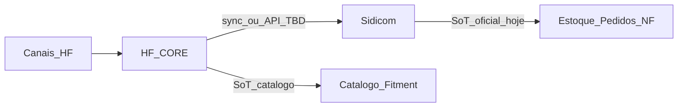

# fonte — Dados e relações × HF × Sidicom

**Data:** 2026-11-23  
**Status:** CANÔNICO (evidência)  
**Fontes fonte:** `FAL_DADOS_FONTES_VERDADE.md`, `DATABASE.md`, auditoria PRD4 §4  
**Fontes HF:** `migrations_hf/`, `HF_DADOS_FONTES_VERDADE.md`, `MODELO_*`

---

## 1. Princípio de SoT (copiar o método, não as tabelas cegas)

Hierarquia fonte de referência em conflito (válida também para HF):

1. Regra de negócio aprovada no PRD  
2. Banco / RPC real  
3. Serviço oficial  
4. Docs recentes  
5. UI  
6. Docs antigas / mocks  

Na coexistência HF: **Sidicom** entra como SoT oficial de vários domínios comerciais até o CORE substituí-lo.

---

## 2. Grafo lógico fonte (resumo)

```text
auth.users → profiles → customers
                         ├── addresses, vehicles, favorites
                         ├── carts → cart_items
                         └── orders → order_items → payments / shipments

manufacturers → models → vehicle_versions
                         └── product_vehicle_compatibility ← products

products ← categories, brands, images, references
products ← supplier_products ← suppliers
products ← inventory ← inventory_movements
products ← price_lists / overrides → resolve_product_price
imports → import_items
```

Três problemas de veículo (não misturar):

| Problema | Tabelas | SoT |
|----------|---------|-----|
| Identidade canônica | manufacturers, models, vehicle_versions | Mestre |
| Normalização / placa | aliases, cached_plates, INV | Aditivo |
| Fitment | `product_vehicle_compatibility` | **Única** prova compatível |

---

## 3. Matriz domínio → SoT fonte → HF hoje → Sidicom → futuro CORE

| Domínio | SoT fonte | HF hoje (`migrations_hf`) | Sidicom (agora) | CORE futuro |
|---------|---------|---------------------------|-----------------|-------------|
| Produto / SKU | `products` | Sim | Cadastro/consulta paralela possível | CORE mestre |
| Categoria / marca | product_* | Sim | — | CORE |
| Fitment PVC | PVC | Sim | — | CORE |
| Identidade veículo | mestre VV | Sim (parcial vs fonte INV) | — | CORE (+ INV se necessário) |
| Import | imports + RPCs | Sim | — | CORE |
| Preço exibição | `resolve_product_price` | Schema/admin; flag off | Preço comercial oficial | CORE + sync |
| Estoque | `inventory` | **Não** no runtime | **SoT** | CORE após migração |
| Cliente comercial | `customers` B2C | B2B customers/groups/catalogs | **SoT** cadastro comercial | CORE CRM |
| Pedido / NF | `orders` + place_order | **Não** | **SoT** | CORE fiscal |
| Pagamento | payments + Edges | **Não** | Condições / financeiro Sidicom | CORE |
| Frete | shipping_quotes / ME | **Não** | Ops + apps entrega | CORE (custo interno; cliente grátis) |
| Favoritos | favorites | Serviço órfão HF | — | Avaliar |
| Garagem | customer_vehicles | Conta veículos parcial | — | Opcional B2B |

---

## 4. O que a HF já tem no SQL próprio

Cadeia `migrations_hf` (não aplicar `fonte-pecas` migrations no projeto HF):

- Core: profiles, staff, veículos base  
- Catálogo: produtos, taxonomia, compat, suppliers  
- B2B: groups, customers, catalogs, visibility  
- RLS + `search_products`  
- Import pipeline + RPCs apply_* (+ price/cost)  
- Storage product-images  
- Published público (migration 08)  

**Proibido:** aplicar as ~210 migrations de referência “para ganhar tempo” no Supabase HF.

---

## 5. Relações críticas a preservar como *padrão*

| Regra fonte de referência | Aplicar na HF? |
|-----------|----------------|
| `status` ≠ `is_available` ≠ estoque ≠ preço | **Sim** (já documentado) |
| Import não publica (draft) | **Sim** |
| Fitment só via PVC | **Sim** |
| Preço só via RPC de resolução na cobrança | **Sim** quando ligar preço |
| Pedido só via contrato único (`place_order`) | **Sim** no CORE (não INSERT solto) |
| INV aditivo não substitui mestre | **Sim** se/quando houver placa |

---

## 6. Adaptações de dados HF (checklist)

Ao portar estrutura fonte de referência → HF:

- [ ] Remover/neutralizar campos e seeds de marca fonte de referência  
- [ ] Modelar **B2B** (CNPJ, grupo, lista) — HF já começou; fonte é B2C-centrado  
- [ ] Não criar `orders` no app enquanto Sidicom for SoT sem estratégia de sync  
- [ ] Estoque: ou integração Sidicom, ou módulo CORE — nunca dois SoT sem regra  
- [ ] Frete: tabela de **custo interno** + flag “cliente grátis”; não espelhar checkout fonte cobrando frete  
- [ ] Validar overlap `migrations_hf` numbered vs foundation blob em fresh DB  

---

## 7. Diagrama coexistência (alvo documental)


