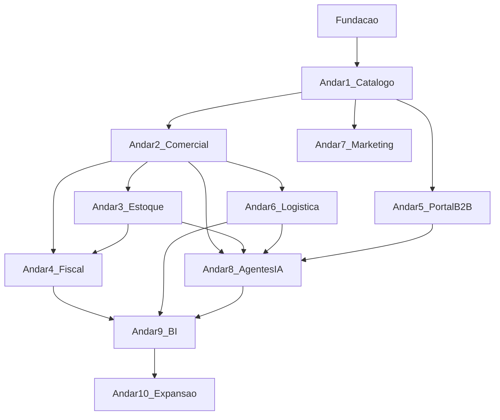

# PRD-Mestre 2036 — HF Comércio de Peças

**Versão:** 1.0  
**Data:** 2026-11-23  
**Status:** CANÔNICO (documento central do ecossistema — validação capítulo a capítulo)  
**Horizonte:** 2036  
**Empresa:** HF Comércio de Peças — Guarulhos/SP  
**Site vivo:** [hfcomerciodepecas.com](https://hfcomerciodepecas.com)

**Visão:** [HF_VISAO_2036.md](./HF_VISAO_2036.md)  
**Identidade:** [HF_IDENTIDADE_VISUAL.md](./HF_IDENTIDADE_VISUAL.md)  
**Índice:** [HF_INDICE_CANONICO.md](./HF_INDICE_CANONICO.md)  
**Cruzamento GPT×HF:** [HF_CRUZAMENTO_PRD_GPT.md](../auditoria/HF_CRUZAMENTO_PRD_GPT.md)  
**Referência técnica:** [HF_REF_APROVEITAMENTO_DETALHADO.md](../auditoria/fonte/HF_REF_APROVEITAMENTO_DETALHADO.md)  
**Sidicom:** [HF_SIDICOM_E_TRANSICAO.md](../operacao/HF_SIDICOM_E_TRANSICAO.md)  
**Frete:** [HF_LOGISTICA_FRETE_GRATIS.md](../operacao/HF_LOGISTICA_FRETE_GRATIS.md)  
**IA / 99 / Uber:** [HF_INTEGRACOES_E_AGENTES_PREP.md](../arquitetura/HF_INTEGRACOES_E_AGENTES_PREP.md)  
**Fase 1:** [PRD_FASE_01.md](../fases/FASE_01_CATALOGO_DIGITAL/PRD_FASE_01.md)

---

## Taxonomia deste documento

| Tag | Significado |
|-----|-------------|
| **[Definido]** | Já estabelecido nas decisões HF, no site, no código ou na operação documentada |
| **[Proposto]** | Estrutura recomendada para organizar e desenvolver — evolutiva |
| **[Pendente]** | Não virar regra sem validação do dono / fornecedor (ex.: D5 Sidicom) |

a referência entra **apenas** como referência auxiliar. A necessidade da HF vem primeiro.  
Projetamos o **prédio inteiro**; detalhamos e desenvolvemos **cada andar** no momento adequado.

---

## Sumário

1. [Propósito e hierarquia documental](#1-propósito-e-hierarquia-documental)  
2. [Visão estratégica e posicionamento](#2-visão-estratégica-e-posicionamento)  
3. [Modelo de negócio e cadeia de valor](#3-modelo-de-negócio-e-cadeia-de-valor)  
4. [Organização e departamentos](#4-organização-e-departamentos)  
5. [Ecossistema tecnológico e HF CORE](#5-ecossistema-tecnológico-e-hf-core)  
6. [Prédio — Fundação e 10 andares](#6-prédio--fundação-e-10-andares)  
7. [Modelo central de dados](#7-modelo-central-de-dados)  
8. [Arquitetura e infraestrutura](#8-arquitetura-e-infraestrutura)  
9. [Integrações externas](#9-integrações-externas)  
10. [Inteligência artificial e automação](#10-inteligência-artificial-e-automação)  
11. [UX, identidade e interfaces](#11-ux-identidade-e-interfaces)  
12. [Segurança, LGPD e governança](#12-segurança-lgpd-e-governança)  
13. [Requisitos não funcionais](#13-requisitos-não-funcionais)  
14. [Processos transversais](#14-processos-transversais)  
15. [Onda, dependências e gates](#15-onda-dependências-e-gates)  
16. [Indicadores](#16-indicadores)  
17. [Riscos](#17-riscos)  
18. [Decisões pendentes](#18-decisões-pendentes)  
19. [Rastreabilidade e referência técnica](#19-rastreabilidade-e-fonte)  
20. [Mapa documental HF](#20-mapa-documental-hf)  
21. [Resultado esperado, próxima etapa e princípio](#21-resultado-esperado-próxima-etapa-e-princípio)  
22. [Apêndice — evidência do site](#22-apêndice--evidência-do-site)

---

# 1. Propósito e hierarquia documental

## 1.1 O que é o PRD-Mestre **[Definido]**

Documento **central** do Projeto HF. Descreve o ecossistema empresarial, operacional e tecnológico até 2036:

- Visão, modelo de negócio, organização  
- Processos comerciais e operacionais  
- Arquitetura, módulos, dados, integrações  
- IA, segurança, KPIs, expansão  
- Fases, dependências, gates e critérios de evolução  

Serve a decisões empresariais, especificação técnica, desenvolvimento, contratação e operação.

## 1.2 Três níveis documentais **[Definido]**

```text
PRD-Mestre (este)
  → PRD da fase (andar)
    → Especificação técnica / dados / UX / testes / homologação / runbook
      → Desenvolvimento → Testes → Homologação → Operação
```

| Nível | Função |
|-------|--------|
| 1 — Mestre | Ecossistema completo, relações, evolução |
| 2 — Fase | Escopo aprofundado do que será desenvolvido agora |
| 3 — Técnico/ops | Implementação, contratos, manuais |

**Regra:** o Mestre não substitui o PRD da fase. A fase não redefine o prédio sem atualizar o Mestre.

## 1.3 Método da onda **[Definido]**

```text
PRD-Mestre → PRD Fase N → Gate N → PRD Fase N+1
Planejar N+1 durante homologação de N = OK
Implementar N+1 sem Gate = NÃO
```

Prep de contratos (IA, 99/Uber, Sidicom) pode começar cedo; **ligar em produção** só no andar certo.

---

# 2. Visão estratégica e posicionamento

## 2.1 Essência **[Definido]**

A **HF Comércio de Peças** é uma **distribuidora de autopeças** em Guarulhos/SP, especializada em **suspensão, direção e freios**, com delivery e ambição de expansão nacional.

Não é marketplace multi-vendedor, nem “só um site institucional”.

| Campo | Valor | Fonte |
|-------|-------|-------|
| Nome | HF Comércio de Peças | site + `business.ts` |
| Tagline | Distribuidora automotiva especializada em suspensão, direção e freios | `business.ts` |
| Hero site | Encontre a peça certa para o seu negócio | hfcomerciodepecas.com |
| Posicionamento catálogo | Catálogo B2B autorizado — sem preço público | site |
| Base | Av. Rosa Molina Pannochia, 424 — Guarulhos/SP | site + business |
| E-mail | marketing@hfcomerciodepecas.com | site |
| Horário | Seg–Sex 08h–18h · Sáb 09h–14h | site + Sobre |
| Instagram | @hfsuspensao | business |
| Público | Lojas de autopeças, oficinas, profissionais B2B | Sobre + Visão |

## 2.2 Ambição 2036 **[Definido]**

Evoluir de operação parcialmente manual/sistemas separados para **ecossistema integrado**:

- Núcleo físico: estoque + distribuição + delivery  
- Camada tech: HF CORE, catálogo inteligente, portal B2B  
- Serviços: atendimento, relacionamento, WhatsApp, IA assistida  
- Expansão nacional sem abandonar identidade de distribuidora  

Pilares do site (/Sobre) **[Definido — copy live]**: competitividade comercial; suporte na identificação de peças; variedade; atendimento próximo e parceria.

## 2.3 Sidicom → HF CORE **[Definido]**

| Horizonte | Sistema | Papel |
|-----------|---------|-------|
| Hoje | **Sidicom** | ERP oficial (clientes, estoque, pedidos, condições, NF) |
| Transição | CORE + Sidicom | Canais digitais no CORE; oficiais no Sidicom até corte |
| Longo prazo | **HF CORE** | Substitui completamente o Sidicom |

D5 (capacidades reais de API/export) = **[Pendente]** — bloqueia automação de pedido/estoque em produção.

## 2.4 Frete grátis **[Definido]**

Cliente: frete **R$ 0**. HF absorve custo (frota, 99, Uber, transportadora).  
Sistema deve registrar **custo interno** e impacto na margem. Política futura configurável sem reconstruir o módulo.

## 2.5 Não-objetivos **[Definido]**

| Não | Motivo |
|-----|--------|
| Marketplace multi-vendedor | Essência distribuidora |
| Copiar PRD/visual de terceiros | Linhagem ≠ negócio |
| Checkout/estoque/IA/99 em prod sem Gate | Ordem do prédio |
| Desligar Sidicom sem paralelo | Risco fiscal/ops |

---

# 3. Modelo de negócio e cadeia de valor

## 3.1 Modelo central **[Definido]**

```text
FORNECEDORES → HF → CLIENTES B2B → CONSUMIDOR FINAL
```

HF: seleção de fornecedores, aquisição, estoque, identificação de aplicações, comercialização, separação e distribuição.

## 3.2 Cadeia de valor **[Proposto]**

1. Identificação da demanda  
2. Planejamento de compras  
3. Seleção de fornecedores  
4. Aquisição  
5. Recebimento  
6. Conferência  
7. Armazenamento  
8. Cadastro e classificação  
9. Divulgação e comercialização  
10. Atendimento e cotação  
11. Processamento de pedidos  
12. Separação  
13. Conferência  
14. Expedição  
15. Entrega (frete grátis ao cliente)  
16. Pós-venda  
17. Análise de desempenho  

## 3.3 Receita **[Definido + Pendente]**

**Definido:** núcleo = comercialização de peças.  
**Pendente:** metas numéricas, novos serviços, expansão de mix (D2).

## 3.4 Relacionamento **[Proposto]**

Prospecção → cadastro → qualificação → atendimento → aplicações → cotação → negociação → venda → entrega → pós-venda → reativação → fidelização.  
Sistema deve preservar histórico entre canais e colaboradores.

---

# 4. Organização e departamentos

Estrutura-alvo **[Proposto]**. Não afirma que todos os departamentos já existem formalmente. RACI com nomes = **[Pendente]**.

| Departamento | Responsabilidades-chave | Capacidades tech (alvo) | Andar |
|--------------|-------------------------|-------------------------|-------|
| Direção | Estratégia, metas, política comercial/compras, expansão | Visão consolidada / BI | 9–10 |
| Comercial | Prospecção, cotação, pedidos, WA, pós-venda | CRM, cotação, pedidos, agente comercial | 1–2, 8 |
| Compras | Fornecedores, reposição, pedidos de compra | Suppliers, conversões, sugestões | 3 |
| Estoque | Recebimento, endereçamento, inventário, separação | Saldos, reservas, movimentos | 3 |
| Logística | Rotas, frota, 99/Uber, comprovantes | Adapters entrega, ledger frete | 6 |
| Financeiro/Fiscal | Títulos, crédito, NF | Integração Sidicom→CORE | 4 |
| Marketing | Campanhas, leads, conteúdo | Origem, conversão | 7 |
| Tecnologia/Dados | Dev, segurança, IA, integrações | CORE, flags, auditoria | F–8 |

Detalhe vivo: [HF_MODELO_OPERACIONAL.md](../operacao/HF_MODELO_OPERACIONAL.md).

---

# 5. Ecossistema tecnológico e HF CORE

## 5.1 Visão conceitual **[Proposto]**

```text
                    ECOSSISTEMA HF
                           |
                    HF CORE / NÚCLEO
                           |
        Dados centrais · Regras · Segurança · Eventos
                           |
     Catálogo · Comercial · Operação · Financeiro · Marketing · IA
                           |
              Site | WhatsApp | Portal | APIs | 99/Uber
                           |
                         BI
```

## 5.2 HF CORE **[Definido estratégia / Proposto forma]**

Núcleo lógico (não necessariamente um único serviço) que coordena identidades, cadastros, regras, pedidos, estoque, integrações, eventos e auditoria.  
MVP atual = SPA React + Supabase; CORE cresce andar a andar.

## 5.3 Princípios **[Definido]**

1. Dados mestres centralizados (cadastro único)  
2. Domínios separados: `IDENTIDADE ≠ CATÁLOGO ≠ ACESSO ≠ PREÇO ≠ ESTOQUE ≠ PEDIDO`  
3. Regras fora da UI; serviços reutilizáveis  
4. Integrações por contrato  
5. Menor privilégio; histórico e rastreabilidade  
6. Compatibilidade com Sidicom na transição  
7. Feature flags antes de ligar capacidade comercial  

## 5.4 Cadastro único **[Definido]**

Um produto (e cliente, fornecedor, veículo) tem identidade estável que alimenta catálogo, admin, cotação, pedido, estoque, portal, WA, IA e BI — sem cópias conflitantes.

---

# 6. Prédio — Fundação e 10 andares

Cada andar abaixo usa o padrão: objetivo · fora · personas · processos · regras · dados · integrações · prep · KPIs · RF/RNF mestre · Gate · fonte.



---

## 6.F Fundação (Módulo A — Identidade e segurança) **[Definido parcial]**

| Campo | Conteúdo |
|-------|----------|
| Objetivo | Auth, profiles, roles, RLS, flags, SoT, deploy, governança |
| Fora | Pedidos, estoque live, agentes, 99/Uber |
| Personas | Admin, staff, futuro cliente |
| Dados | `profiles`, roles, feature flags |
| Integrações | Supabase Auth; estudo Sidicom (D5) |
| Prep | Flags `ai_*`, `delivery_*` off; secrets fora do front |
| Gate F | Projeto HF isolado da referência; RLS; deploy Hostinger; docs índice |
| Fonte | REUSAR auth/guards; ADAPTAR roles HF; NAO_TRAZER secrets de terceiros |

**RF-F (mestre):** login/recuperação; staff bootstrap; RLS; auditoria de acesso; gestão de operadores.

---

## 6.1 Andar 1 — Catálogo Digital (Módulo B) **[Definido + em curso]**

| Campo | Conteúdo |
|-------|----------|
| Objetivo | Presença digital + identificação confiável de produtos/aplicações; WA; leads |
| Fora | Carrinho, checkout, pay, estoque tempo real, frete API, agentes prod |
| Personas | Visitante/B2B (D1), staff catálogo, atendimento |
| Processos | Cadastro → draft → publish → busca → PDP → WA/cotação |
| Regras | Import → draft; status ≠ preço ≠ estoque; sem preço público (site) |
| Dados | products*, categories, brands, refs, PVC, vehicles, imports; **P0** `customer_vehicles` |
| Integrações | WhatsApp CTA (`VITE_WHATSAPP_NUMBER`); Sidicom estudo |
| Prep | SKU/IDs estáveis para IA; eventos `product.published` |
| KPIs | SKUs published, apps validadas, leads WA, taxa busca útil |
| Gate 01 | Ver [PRD_FASE_01.md](../fases/FASE_01_CATALOGO_DIGITAL/PRD_FASE_01.md) |
| Fonte | REUSAR §§catálogo/veículos/import; ADAPTAR PDP/Home; CORRIGIR_HF P0/P1 |

### Escopo funcional Andar 1 (detalhe)

**B.1 Institucional:** home, sobre, contato, identidade HF.  
**B.2 Catálogo:** listagem, categorias, marcas, imagens, PDP.  
**B.3 Busca:** nome, códigos HF/OEM/equiv, categoria, marca, montadora/modelo/versão/ano/posição.  
**B.4 Estrutura veicular:** montadora → modelo → versão → anos.  
**B.5 Aplicações:** produto↔veículo + período + posição (E/D, diant/tras, etc.) + fonte/validação.  
**B.6 Referências:** tipos separados do produto; vínculo fornecedor.  
**B.7 Captação:** WA, cotação, lead, origem — visitante ≠ lead ≠ cliente aprovado.  
**B.8 Admin:** CRUD + publish + import.  
**B.9 Import:** CSV/XLSX, preview, draft, erros, histórico.  

**D1 [Pendente]:** site diz “B2B autorizado”; migration 08 permite anon published — fechar política.

---

## 6.2 Andar 2 — Comercial / CRM / pedidos (Módulos C–E) **[Proposto]**

| Campo | Conteúdo |
|-------|----------|
| Objetivo | Digitalizar cotação e pedido com sync Sidicom |
| Fora | Substituir Sidicom; IA fechando venda sozinha |
| Dependências | Gate 01 + D5 iniciado |
| Dados | leads, quotes, orders/itens (a criar); customers B2B (parcial hoje) |
| Integrações | Sidicom SoT pedido; prep tools `draft_order` / `confirm_order` |
| Regras | Cotação ≠ venda confirmada; frete cliente = 0; anti-duplicidade |
| Gate 02 | Pedido rastreável + espelho Sidicom definido |
| Fonte | ADAPTAR cart/checkout/place_order; NAO_TRAZER B2C/MP |

Estados conceituais **[Proposto]:** rascunho → enviada → aprovada → pedido → separação → expedição → entregue / cancelada.

---

## 6.3 Andar 3 — Estoque e compras (Módulos F–G) **[Proposto]**

| Campo | Conteúdo |
|-------|----------|
| Objetivo | Visibilidade física + reposição; Sidicom SoT até corte |
| Conceitos | físico ≠ reservado ≠ disponível ≠ em trânsito ≠ conferência |
| Dados | deposits, balances, movements, PO; supplier_products (parcial) |
| Prep IA | tool `get_stock` |
| Gate 03 | Um writer de estoque; saldos conciliáveis |
| Fonte | ADAPTAR inventory; sync Sidicom primeiro |

Compras: solicitação → sugestão → cotação fornecedor → PO → recebimento → custo.  
Planejamento: demanda, prazo, mínimo, segurança, lote — fórmulas **[Pendente]**.

---

## 6.4 Andar 4 — Financeiro e fiscal (Módulo I) **[Proposto]**

Contas pagar/receber, crédito, cobrança, NF, integração fiscal.  
Emissão própria só após avaliação Sidicom + provedores **[Pendente]**.  
Agentes **não** emitem NF sozinhos.

---

## 6.5 Andar 5 — Portal B2B (Módulo D/J) **[Proposto + parcial schema]**

Login cliente, usuários da empresa, listas/preços autorizados, cotações/pedidos, histórico.  
Portal ≠ e-commerce com pagamento online obrigatório.  
Depende D1 + Andar 2.

Estados cliente **[Proposto]:** visitante → interessado → solicitado → análise → aprovado → bloqueado/inativo.

---

## 6.6 Andar 6 — Logística (Módulo K) **[Definido política / Proposto software]**

| Campo | Conteúdo |
|-------|----------|
| Objetivo | Separação, expedição, entrega; ledger frete |
| Política | Frete grátis cliente; fee = custo interno |
| Providers | frota \| manual \| **99 Entrega** \| **Uber Direct** \| transportadora |
| Dados | deliveries, modality, fee, tracking, comprovantes |
| Gate 06 | Sandbox 99/Uber + ledger + pedido digital homologado |
| Fonte | NAO_TRAZER ME cobrado; ADAPTAR packing/frota; CONSTRUIR_HF adapters |

Distinção obrigatória **[Definido]:** valor cobrado do cliente (0) ≠ custo contratado ≠ custo frota ≠ margem após logística.

---

## 6.7 Andar 7 — Marketing (Módulo L) **[Proposto]**

Campanhas, origem de lead, conversão, conteúdo, Instagram/Google sob avaliação.  
Não obrigatório ManyChat/Meta na base.

---

## 6.8 Andar 8 — Inteligência artificial (Módulo M) **[Proposto]**

Agentes: comercial, catálogo, estoque, compras, logístico, gerencial.  
Arquitetura: identidade, tools, escopos, auditoria, aprovação humana, falhas.  
**Princípio [Definido]:** IA não confirma operações irreversíveis sem permissão/aprovação.  
Prep desde andares 1–6; produção só após Gate 08.

---

## 6.9 Andar 9 — BI (Módulo N) **[Proposto]**

Dashboards comercial, produto, compras, estoque, logística (custo frete), financeiro, gestão, uso de IA.  
Fórmulas e origem documentadas; metas numéricas **[Pendente]**.

---

## 6.10 Andar 10 — Expansão (Módulo O) **[Proposto]**

Multi-CD, novas regiões, app, novos canais — conforme D3/D4 e CORE maduro.

---

# 7. Modelo central de dados

## 7.1 Princípio **[Definido]**

Banco representa a realidade HF. Sem cópias incompatíveis. Identidade estável + histórico + relacionamentos.

## 7.2 Domínios **[Proposto mapa / Definido subset vivo]**

| Domínio | Entidades (alvo) | Estado |
|---------|------------------|--------|
| Identidade | users, profiles, roles | Vivo |
| Produtos | products, categories, brands, images, refs | Vivo |
| Automotivo | manufacturers, models, versions, PVC/apps | Vivo |
| Fornecedores | suppliers, supplier_products, costs | Vivo parcial |
| Clientes B2B | customers, groups, catalogs | Vivo admin |
| Comercial | leads, quotes, orders | Futuro Andar 2 |
| Estoque | balances, movements, reservations | Futuro Andar 3 / Sidicom |
| Compras | PO, receipts | Futuro Andar 3 |
| Financeiro/Fiscal | titles, NF | Futuro Andar 4 / Sidicom |
| Logístico | deliveries, fees | Futuro Andar 6 |
| Marketing | campaigns, origins | Futuro Andar 7 |
| IA | agents, tool runs, approvals | Futuro Andar 8 |

### Já em `migrations_hf` **[Definido]**

`profiles`, `manufacturers`, `models`, `vehicle_versions`, `product_categories`, `product_brands`, `suppliers`, `products`, `product_images`, `product_references`, `product_vehicle_compatibility`, `supplier_products`, `imports`, `import_items`, `import_profiles`, `customer_groups`, `customers`, `customer_users`, `catalogs`, `catalog_products`, `customer_group_catalogs`, `customer_catalogs`, `price_lists`, `price_list_items`, `price_change_history` + RPCs.

### Precisa estruturar

| Estrutura | Andar | Ação |
|-----------|-------|------|
| `customer_vehicles` + RLS | 1 | **CORRIGIR_HF P0** |
| Pedidos / itens / cotações | 2 | CONSTRUIR/ADAPTAR + Sidicom |
| Estoque / movimentos | 3 | Sync Sidicom primeiro |
| Frete interno / modalidade | 6 | CONSTRUIR_HF |
| Bridge Sidicom (outbox/sync) | F–4 | CONSTRUIR_HF |
| favorites / carts / MP | — | NAO_TRAZER até decisão |

### Relação catálogo **[Definido]**

```text
PRODUTO → categoria, marca peça, imagens, referências, fornecedores
       → APLICAÇÕES → VEÍCULO (montadora/modelo/versão/ano) + posição + período
```

Kits/composição **[Proposto / Pendente negócio]** — arquitetura permite; implantar só se HF vender kit.

Governança: IDs estáveis, validação, origem, histórico, exclusão lógica, integridade.

**Nunca** aplicar ~210 migrations de referência de uma vez no Supabase HF.

---

# 8. Arquitetura e infraestrutura

## 8.1 Stack atual **[Definido]**

React 19 + TypeScript + Vite + React Router 7 + Tailwind 4 + Supabase (Auth, Postgres, Storage, RLS).  
Projeto: `owllmfcpbodqmoerdfxx` (sa-east-1).  
Camadas: pages → hooks/contexts → **services** → `lib/supabase` (anon).  
Evolução de stack = decisão formal (custo × benefício), não default.

## 8.2 Camadas **[Proposto]**

Apresentação · Aplicação (casos de uso) · Domínio · Infraestrutura (DB, filas, APIs, monitoramento).

## 8.3 Ambientes **[Proposto / Parcial]**

Dev · Homologação · Produção · backups · secrets · deploy Hostinger · logs · DR.

## 8.4 Integração interna **[Proposto]**

APIs, webhooks, filas, eventos, sync programada, import/export, async — conforme confiabilidade do fluxo.

Docs: [HF_ARQUITETURA_PADRAO.md](../arquitetura/HF_ARQUITETURA_PADRAO.md), [HF_DADOS_FONTES_VERDADE.md](../arquitetura/HF_DADOS_FONTES_VERDADE.md).

---

# 9. Integrações externas

## 9.1 Sidicom **[Definido prioridade / Pendente D5]**

Estudo obrigatório: API, export, e-commerce Sidicom, estoque, pedidos, clientes, preços, fiscal.  
Questionário: ver Sidicom doc §5.  
Sem D5: sem piloto de agente de pedido em produção.

## 9.2 WhatsApp **[Definido CTA / Proposto automação]**

CTA oficial Fase 1. Futuro: OTP, notificações, agente (Andar 8) com políticas da plataforma.

## 9.3 99 Entrega e Uber Direct **[Proposto Andar 6]**

| Provider | Evidência | Uso HF |
|----------|-----------|--------|
| 99 Entrega | OAuth `entrega.order`; estimate/create | fee → custo interno |
| Uber Direct | Create Delivery; sandbox→piloto→prod | idem |

## 9.4 Financeiro / fiscal / marketing **[Proposto]**

Bancos, Pix, boletos, provedores fiscais, Google/Meta/Analytics — avaliar por fase; não obrigatórios no Andar 1.

---

# 10. Inteligência artificial e automação

## 10.1 Níveis **[Proposto]**

| Nível | Nome | Comportamento |
|-------|------|---------------|
| 1 | Assistência | Consulta e responde |
| 2 | Preparação | Monta cadastros/cotações/análises |
| 3 | Execução autorizada | Ações permitidas |
| 4 | Orquestração | Coordena módulos com limites |

## 10.2 Tools (contratos a reservar) **[Proposto]**

`search_catalog` · `get_product` · `get_product_application` · `get_customer` · `get_authorized_price` · `get_stock` · `draft_quotation` · `draft_order` · `confirm_order` · `quote_delivery_cost` · `dispatch_delivery` · `get_order_status` · `suggest_purchase`

SoT de escrita: Sidicom ou CORE conforme domínio. Humano no loop em operações sensíveis.

## 10.3 KPIs de IA **[Proposto]**

Precisão, resolução, encaminhamento humano, erros de peça, tempo economizado, custo, falhas de tool.

Detalhe: [HF_INTEGRACOES_E_AGENTES_PREP.md](../arquitetura/HF_INTEGRACOES_E_AGENTES_PREP.md).

---

# 11. UX, identidade e interfaces

## 11.1 Princípio **[Definido]**

Interface para distribuidora B2B: rapidez, clareza, poucos passos, consistência, responsivo.  
Identidade **própria HF** (`--hf-*`). Proibido tokens externos.

## 11.2 Interfaces

| Superfície | Estado |
|------------|--------|
| Pública (home, catálogo, busca, PDP, sobre, atendimento) | Viva no site |
| Admin (produtos, veículos, import, clientes, preços, operadores) | Viva |
| Portal B2B | Schema parcial; UX Andar 5 |
| Comercial/estoque/logística/financeiro | Futuro |

## 11.3 Marca **[Definido parcial]**

Tokens dark + vermelho HF; CTA WhatsApp; hero/copy alinhados ao site.  
Tipografia atual no app: Inter (gap: guia de marca tipográfica).  
Doc: [HF_IDENTIDADE_VISUAL.md](./HF_IDENTIDADE_VISUAL.md).  
Usabilidade ops: [HF_PADRAO_TELAS_UX_OPERACIONAL.md](./HF_PADRAO_TELAS_UX_OPERACIONAL.md).

PDP MVP: **CONSULTAR ESTA PEÇA** (WA) — sem comprar/preço público.

---

# 12. Segurança, LGPD e governança

## 12.1 Segurança **[Definido parcial]**

Auth, RLS, services, secrets em env, validação, auditoria, backups, menor privilégio.

## 12.2 LGPD **[Proposto]**

Base legal, finalidade, minimização, retenção, direitos, incidentes, compartilhamento (placa/OTPs futuros).

## 12.3 Auditoria **[Proposto]**

Usuário, ação, entidade, antes/depois, origem, resultado — especialmente agentes e alterações de preço/estoque/pedido.

## 12.4 Governança de decisão **[Definido]**

Categorias: aprovada · proposta · pendência · restrição · risco · alteração · rejeição.  
Documentar justificativa e impacto.

---

# 13. Requisitos não funcionais

Valores quantitativos nos PRDs técnicos. Categorias **[Proposto]**:

Desempenho (busca, paginação, async) · Escalabilidade · Disponibilidade · Manutenibilidade · Compatibilidade (desktop/mobile) · Integridade · Privacidade · Usabilidade.

---

# 14. Processos transversais **[Proposto]**

1. **Produto→venda:** cadastro → publish → busca → app → cotação → pedido → separação → entrega → pós-venda  
2. **Necessidade→compra:** demanda → estoque → sugestão → PO → recebimento → custo  
3. **Cliente→relacionamento:** lead → qualificação → aprovação → atendimento → venda → fidelização  
4. **Pedido→entrega:** validação → disponibilidade → picking → expedição → 99/Uber/frota → comprovação  
5. **Dado→decisão:** ops → indicadores → ação  
6. **IA→execução:** contexto → tool autorizada → preparação → aprovação → execução → log  

---

# 15. Onda, dependências e gates

## 15.1 Ordem oficial **[Definido]**

| Ordem | Documento | Status |
|-------|-----------|--------|
| 0 | Este PRD-Mestre | **v1.0** |
| 1 | `FASE_01_CATALOGO_DIGITAL/PRD_FASE_01.md` | Em detalhamento |
| 2…10 | `FASE_0N_*` | Após gates |

## 15.2 Dependências **[Definido]**

| Capacidade | Depende de |
|------------|------------|
| Catálogo | Fundação |
| CRM / cotações / pedidos | Catálogo + D5 |
| Estoque / compras | Sidicom SoT + produtos |
| Financeiro / fiscal | Pedidos + Sidicom |
| Portal B2B | Identidade + clientes + comercial + D1 |
| Logística / 99 / Uber | Pedido digital + política frete |
| IA comercial | Catálogo + CRM + pedidos + auditoria |
| BI | Dados confiáveis dos andares |

## 15.3 Gate genérico **[Definido]**

Objetivos · RF/RNF · regras · dados · permissões · integrações · testes · docs · treino · pendências · aprovação formal · liberação do próximo.

Preparar PRD N+1 durante homologação = OK. Implementar sem Gate = NÃO.

## 15.4 Template RF/RNF de fase **[Proposto]**

RF: ID, nome, objetivo, descrição, usuário, pré-condições, fluxo, alternativos, regras, dados, permissões, integrações, exceções, resultado, aceite, prioridade.  
RNF: ID, categoria, descrição, justificativa, métrica, validação, ambiente, responsável.

---

# 16. Indicadores **[Proposto / Pendente metas]**

| Bloco | Exemplos |
|-------|----------|
| Estratégico | Faturamento, clientes ativos, retenção, margem, expansão |
| Comercial | Leads, cotações, pedidos, ticket, tempo atendimento, recompra |
| Operacional | Separação, expedição, ruptura, acurácia estoque, prazo entrega |
| Logística | Custo frete interno / pedido, on-time, ocorrências |
| Tecnológico | Disponibilidade, erros, import success, incidentes |
| IA | Precisão, resolução, escalonamento humano, custo |

Metas numéricas: **[Pendente]** após baseline.

---

# 17. Riscos **[Proposto]**

| Tipo | Exemplos | Mitigação |
|------|----------|-----------|
| Empresarial | Sem RACI, compras só reativas | Modelo operacional + gates |
| Tecnológico | Dois SoT, migrations de referência em lote, flags prematuras | SoT doc + matriz de referência + gates |
| Dados | Apps/refs erradas, import sem validação | Draft + validação + auditoria |
| IA | Peça errada, vazamento, execução indevida | Tools + humano + auditoria |

Cada risco: probabilidade, impacto, responsável, prevenção, contingência.

---

# 18. Decisões pendentes

| ID | Tema | Impacto |
|----|------|---------|
| D1 | Catálogo aberto vs login B2B (site já fala autorizado / sem preço público) | Flag + RLS + UX |
| D2 | Mix além de suspensão/direção/freios | Catálogo/compras |
| D3 | Frota / terceiros / híbrido 2036 | Andar 6 |
| D4 | CDs / unidades expansão | Andar 10 |
| D5 | API/export/e-commerce Sidicom reais | Andares 2–4, 8 |
| — | Organograma e RACI com nomes | Ops |
| — | Política preço vitrine / listas | Andar 2/5 |
| — | Fórmulas reposição / inventário | Andar 3 |
| — | Níveis autonomia IA | Andar 8 |
| — | Metas KPI numéricas | Andar 9 |

**Travadas:** Sidicom→CORE; frete grátis universal (config futura); referência só auxiliarerência; stack MVP; onda de andares.

---

# 19. Rastreabilidade e referência técnica

## 19.1 Matriz (modelo vivo) **[Proposto]**

| Objetivo | Módulo | Requisito | Fase | Aceite |
|----------|--------|-----------|------|--------|
| Identificar peças | Catálogo | Busca ref/aplicação | 1 | Busca validada |
| Atendimento | CRM | Histórico | 2 | Histórico disponível |
| Digitalizar vendas | Comercial | Pedidos + Sidicom | 2 | Pedido rastreável |
| Reposição | Compras | Sugestão | 3 | Sugestão validada |
| Estoque | Estoque | Movimentos | 3 | Saldo conciliado |
| Entrega | Logística | 99/Uber/frota + ledger | 6 | Entrega + custo interno |
| Automação | IA | Agente comercial | 8 | Fluxo homologado |
| Gestão | BI | Indicadores | 9 | Indicadores validados |

## 19.2 Referência técnica **[Definido]**

1. Necessidade HF → 2. Solução ideal → 3. Há referência? → 4. Avaliar → 5. Aproveitar só se benefício → 6. Adaptar HF → 7. Validar.  
Matriz: [HF_REF_APROVEITAMENTO_DETALHADO.md](../auditoria/fonte/HF_REF_APROVEITAMENTO_DETALHADO.md).  
**Nunca alterar** a pasta de terceiros.

---

# 20. Mapa documental HF

**Não** renomear a árvore inteira. Autoridade = [HF_INDICE_CANONICO.md](./HF_INDICE_CANONICO.md).

| Pasta | Papel |
|-------|-------|
| `docs/entrada/` | Visão, Mestre, Identidade, Índice, UX ops |
| `docs/arquitetura/` | Arquitetura, SoT, integrações/IA |
| `docs/operacao/` | Org, Sidicom, frete, runbooks |
| `docs/fases/FASE_0N_*/` | PRD + satélites do andar |
| `docs/auditoria/` | Evidência HF + fonte + cruzamento GPT |
| `docs/entrada/referencias/` | Raw modelos externos |

Anexos MVP: `PRD_HF_B2B_1.0`, `PRD_UX_B2B`, `MODELO_CATALOGO`, `ROADMAP_HF`, `HOMOLOGACAO_HF`, etc.

---

# 21. Resultado esperado, próxima etapa e princípio

## 21.1 Resultado esperado **[Proposto]**

Ecossistema capaz de: apresentar a HF; catálogo inteligente; cadastros centrais; CRM; cotações/pedidos; compras/estoque; logística com frete grátis rastreável; financeiro/fiscal; portal B2B; canais; IA assistida; BI; expansão — com Sidicom substituído pelo CORE no longo prazo.

## 21.2 Próxima etapa **[Definido]**

1. Validar este Mestre v1.0 (empresa → CORE/Sidicom → operação → catálogo).  
2. Consolidar diagnóstico atual (já em auditorias).  
3. Fechar D1 + enviar D5.  
4. Detalhar satélites + Gate da **Fase 1**.  
5. Homologar Fase 1 → PRD Fase 2.  

## 21.3 Princípio central **[Definido]**

> O Projeto HF não é medido pela quantidade de features, e sim pela capacidade de conectar processos reais, dados confiáveis e crescimento sustentável.  
> O catálogo é a primeira grande entrega digital. O CORE integra a evolução. A operação física permanece central. A IA amplia capacidade humana.  
> **A HF é o centro. A tecnologia serve à operação.**

---

# 22. Apêndice — evidência do site

Varredura **2026-11-23** — https://hfcomerciodepecas.com

| Página | Achados |
|--------|---------|
| `/` | Hero “Encontre a peça certa…”; “Catálogo B2B autorizado — sem preço público”; endereço; e-mail; WA |
| `/catalogo` | Busca/filtro; menção autorização no servidor (RLS) |
| `/sobre` | Texto de parceria; 4 pilares; horários; imagem estoque |
| Contato | marketing@hfcomerciodepecas.com; Av. Rosa Molina Pannochia, 424 |

Alinhamento `business.ts`: nome, tagline, endereço, e-mail, horários, Instagram, telefones — **Definido** como fonte de copy operacional do app.

---

## Changelog

| Versão | Data | Notas |
|--------|------|-------|
| 0.3 | 2026-11-23 | Esqueleto andares + onda + prep IA/99 |
| **1.0** | 2026-11-23 | Consolidação GPT×HF×site; taxonomia Definido/Proposto/Pendente; prédio completo |

**FIM — PRD-MESTRE HF 2036 v1.0**
