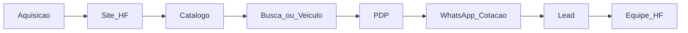

# PRD HF — Andar 1 · Catálogo Digital

**Versão:** 1.1  
**Data:** 2026-11-24  
**Status:** CANÔNICO (especificação de referência — em homologação)  
**Origem:** consolidação HF + modelo GPT ([CRUZAMENTO_GPT_ANDAR1.md](./CRUZAMENTO_GPT_ANDAR1.md))  
**Mestre (intocado):** [HF_PRD_MESTRE_2036.md](../../entrada/HF_PRD_MESTRE_2036.md)  
**Site:** [hfcomerciodepecas.com](https://hfcomerciodepecas.com)

| Campo | Definição |
|-------|-----------|
| Projeto | Ecossistema HF |
| Empresa | HF Comércio de Peças |
| Produto | Catálogo Digital HF |
| Horizonte | HF 2036 |
| Prioridade | Primeira etapa de execução |
| Natureza | Produto digital B2B |
| Público | Lojas de autopeças, oficinas, autocenters, distribuidores |

### Satélites

| Arquivo | Papel |
|---------|-------|
| [ESPECIFICACAO_FUNCIONAL.md](./ESPECIFICACAO_FUNCIONAL.md) | Comportamentos / jornadas |
| [MODELO_DE_DADOS.md](./MODELO_DE_DADOS.md) | Schema subset + P0 |
| [MAPA_DE_TELAS.md](./MAPA_DE_TELAS.md) | Rotas |
| [CRITERIOS_DE_ACEITE.md](./CRITERIOS_DE_ACEITE.md) | Aceite |
| [HOMOLOGACAO.md](./HOMOLOGACAO.md) | Gate 01 |
| [RASTREABILIDADE.md](./RASTREABILIDADE.md) | RF × código × aceite |
| [CRUZAMENTO_GPT_ANDAR1.md](./CRUZAMENTO_GPT_ANDAR1.md) | Evidência fusão |

### Taxonomia

| Tag | Significado |
|-----|-------------|
| **Definido** | Já estabelecido |
| **Existente** | No app — manter/corrigir/homologar |
| **Pendente** | Exige validação |
| **Futuro** | Outro andar |
| **Proposto** | Recomendação deste PRD |

O PRD-Mestre orienta o **prédio**. Este PRD detalha o **Andar 1**.

---

# 1. Visão geral do produto

## 1.1 O que estamos construindo **Definido**

Primeira camada pública e comercial do ecossistema HF — não só site institucional nem lista solta.

Deve: apresentar a HF; organizar o portfólio; consulta de aplicações; identificar peças por veículo/códigos/refs; categorias e marcas; campanhas sem preço público; leads; WhatsApp; base para próximos andares.

## 1.2 Objetivo central **Definido**

Portfólio digital organizado, pesquisável, confiável e escalável — achar peça, validar aplicação, solicitar atendimento.

## 1.3 Posicionamento **Definido**

HF = distribuidora. Site: *Catálogo B2B autorizado — sem preço público.*

## 1.4 Problemas → resposta

| Problema | Resposta |
|----------|----------|
| Achar peças | Busca + filtros |
| Dúvida aplicação | Veículo ↔ produto |
| Códigos diferentes | Referências |
| Info espalhada | Base central |
| Só consulta manual | Pesquisa digital |
| Portfólio pouco claro | PDP / cats / marcas |
| Divulgação fraca | Campanhas P1 |
| Perda oportunidades | Leads + WA |
| Atualização pesada | Admin + import |
| Crescimento caótico | Modelo expansível |

---

# 2. Contexto atual

## 2.1 Arquitetura **Existente**

React 19 · Vite · React Router 7 · Tailwind 4 · Supabase · Hostinger. Next.js não é decisão.

## 2.2 Já no app **Existente**

Home, catálogo, busca, cats, marcas, PDP, /veiculo, auth, admin, CRUD, import, taxonomia, fornecedores, preços staff, clientes/grupos, operadores, WA, flags.

## 2.3 Off na vitrine **Futuro**

Preços públicos, catálogo por cliente, cart, checkout, pedidos, estoque, pay, frete digital, e-commerce.

## 2.4 Antes de expandir **Definido**

Docs↔runtime · D1 · flags · migrations_hf · órfãos P0/P1 · import · testes RLS. Sem reconstrução sem auditoria.

---

# 3. Escopo

**Dentro:** presença · catálogo · inteligência automotiva · pesquisa · campanhas P1 · leads/WA · admin/import.

**Fora / Futuro:** cart · checkout · pay · pedido confirmado · estoque · NF · financeiro · 99/Uber prod · portal B2B condições · substituir Sidicom · agentes IA. Kits: hub Andar 1 vivo — ver §9 / `HF_KITS_PLANO.md`.

### Distinções comerciais **Definido**

Visualização → consulta → lead → solicitação de cotação = Andar 1.  
Pedido confirmado = **Andar 2** (oficial no HF; Sidicom sem integração obrigatória agora).

```text
status ≠ preço ≠ estoque ≠ pedido
```

Import → draft. Vitrine published (+D1). Sem preço público.

---

# 4. Usuários

Visitante · Lead · Cliente cadastrado (sem portal preços) · Operador · Admin.  
auth ≠ autorização ≠ visibilidade ≠ escopo comercial.

---

# 5. Jornadas



---

# 6. Identidade

Home · Sobre · Catálogo · Categorias · Marcas · Campanhas · Atendimento. Tokens `--hf-*`. Mobile prioritário. Contatos do site.

---

# 7. Núcleo catálogo

Produto · Referências · Classificação · Aplicações · Conteúdo · Veículos.  
Status: draft | published | archived.  
Refs: HF, fabricante, OEM, equivalente, fornecedor.  
Marca ≠ fabricante ≠ fornecedor. L1 Suspensão/Direção/Freios.

---

# 8. Inteligência automotiva

Busca bidirecional. App com faixa própria + posição + validação.  
Posições Proposto: lateral · vertical · longitudinal (não só texto livre).  
Fabricação ≠ ano-modelo P1. Equivalência ≠ referência.  
Validação apps Proposto: não revisada → validada / rejeitada. Vitrine só publicáveis. Confrontar PVC antes de migration.

---

# 9. Kits — hub vivo Andar 1 (`/admin/kits`; SoT [`HF_KITS_PLANO.md`](./HF_KITS_PLANO.md)). Evoluções (preço auto, import BOM, estoque) ficam para depois.

# 10. PDP — template dinâmico; WA; sem comprar/preço/estoque.

# 11. Pesquisa — códigos, nome, veículo, filtros, empty state, paginação.

# 12. Campanhas **P1** — sem implicar preço/estoque/pedido.

# 13. Leads — CRM lite + etapas Proposto + LGPD.

# 14. WhatsApp **Definido** — contexto PDP; só `VITE_WHATSAPP_NUMBER`.

# 15. Admin — CRUD completo + dashboard indicadores (não financeiros).

# 16. Import — preview, validação, draft, sem sobrescrita silenciosa.

# 17. Dados — cadastro único; CORE lógico; ver MODELO_DE_DADOS; P0 vehicles; sem orders/carts.

# 18. Integrações — Supabase/Hostinger/WA/CSV Existente; Sidicom **sem** sync obrigatório (D5 opcional); pedido digital oficial = Andar 2 HF (D6); 99/Uber/IA Futuro.

# 19. Segurança — RLS, auditoria, LGPD.

---

# 20. Requisitos funcionais

| ID | Requisito | Pri | Estado |
|----|-----------|-----|--------|
| RF-001 | Institucional | P0 | Existente |
| RF-002 | Catálogo published aberto (D1) | P0 | **OK** |
| RF-003 | Busca nome | P0 | Existente |
| RF-004 | Busca código HF | P0 | Existente |
| RF-005 | Busca refs | P0 | Existente |
| RF-006 | PDP | P0 | Existente |
| RF-007 | Categorias | P0 | Existente |
| RF-008 | Marcas | P1 | Existente |
| RF-009 | Apps por veículo | P0 | Existente |
| RF-010 | Veículos por produto | P0 | Validar |
| RF-011 | Posições estruturadas | P0 | Proposto/gap |
| RF-012 | Fabricação ≠ ano-modelo | P1 | Proposto |
| RF-013 | Faixas aplicação | P0 | Existente |
| RF-014 | Só apps validáveis | P0 | Proposto |
| RF-015 | CTA WA | P0 | Existente |
| RF-016 | Cotação/contato | P0 | Parcial |
| RF-017 | Leads | P0 | Parcial |
| RF-018–022 | Admin catálogo/veículos/apps | P0 | Existente |
| RF-023–024 | Import + validação | P0 | Existente |
| RF-025–026 | Campanhas | P1 | Gap |
| RF-027 | Permissões | P0 | Existente |
| RF-028 | Histórico | P1 | Parcial |
| RF-029 | Indicadores admin | P1 | Parcial |
| RF-030 | Base expansão | P0 | Governança |
| RF-031 | P0 veículos conta | P0 | **OK** (DB HF 2026-11-24) |
| RF-032 | Órfãos P1 | P1 | OK |
| RF-033 | Registrar D1 (published aberto) | P0 | **OK** 2026-11-24 |
| RF-034 | D5 Sidicom (opcional) | — | **Fora do Gate** — pacote pronto / sob demanda |
| RF-035 | SKUs estáveis | P0 | Governança |
| RF-036 | Sem preço público | P0 | Definido |

---

# 21. RNF

Responsivo · mobile · RLS · escalável · SEO · testável · `--hf-*` · test+build · sem secrets de terceiros. SLA = Pendente.

# 22–25. SEO · métricas · testes · aceite

Ver CRITERIOS_DE_ACEITE.md e HOMOLOGACAO.md. Gate: P0/P1/D1 + jornadas P0 (**sem** D5).

# 26. Plano

1 Auditoria · 2 Fundação · 3 Automotivo · 4 UX pública · 5 Admin/import · 6 Marketing · 7 Testes · 8 Deploy.

# 27. Próximos andares consomem identidade de produto — não duplicar.

# 28. Riscos: apps erradas, duplicidade, migrations, RLS, import, over-scope, misturar pedido Andar 2 com sync Sidicom prematuro.

# 29. Pendentes e decisões fechadas

### Fechadas neste Gate

| ID | Decisão |
|----|---------|
| **D1** | Catálogo published **aberto**; sem preço público; “B2B autorizado” = posicionamento (2026-11-24) |
| **D6** | Pedido digital oficial = **HF Andar 2**; sem integração Sidicom agora (2026-11-24) |
| **D5** | Sidicom questionário = **opcional/adiado** — **não** bloqueia Gate 01 |
| **P0** | `customer_vehicles` aplicada no Supabase HF (`12_customer_vehicles` / migration MCP) |

### Ainda pendentes

| ID | Tema | Situação |
|----|------|----------|
| D-02 | Preços públicos | Não aprovado |
| D-03 | Preço por cliente | **Parcial** (2026-11-25): lista `assigned` + `priceVisible` B2B; portal/checkout ainda futuro |
| D-04…08 | Fontes/campos/equivalência/leads/validadores | Pendente |
| **D7** | Estoque/NF no Andar 2: Sidicom/manual vs HF? | Abrir com dono antes do PRD Andar 2 |
| D-10…14 | SLA, analytics, retenção, kits, refs | Pendente |
| D5 (sob demanda) | Sidicom API | Pacote em [D5_SIDICOM_QUESTIONARIO_ENVIO.md](./D5_SIDICOM_QUESTIONARIO_ENVIO.md) |

# 30–32. Governança · conclusão (10 capacidades) · 3 revisões (negócio/catálogo/técnica) antes de features novas.

### Correções Gate

P0 customer_vehicles · P1 órfãos · P2 placeholder.

---

**Changelog:** 1.0 → **1.1** — fusão GPT×HF (posições, leads, campanhas, SEO, plano, RF-001…036).  
**Gate 01 (2026-11-24):** auditoria + smoke + waivers RF-011/012/014/017/025; D5 fora; D6 Andar 2 HF; fix `handle_new_user`; Homologação pronta para assinatura do dono — ver [AUDITORIA_GATE01_2026-11-24.md](./AUDITORIA_GATE01_2026-11-24.md) e [HOMOLOGACAO.md](./HOMOLOGACAO.md).
